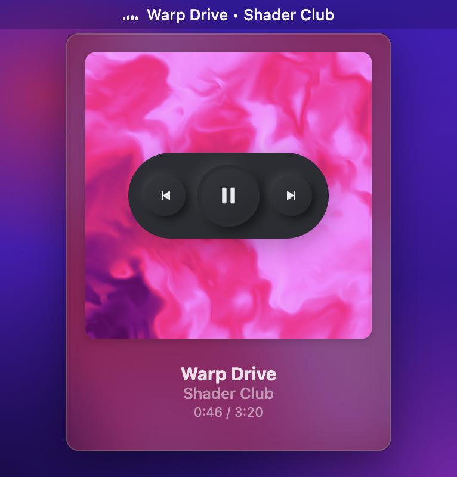
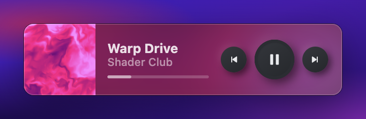
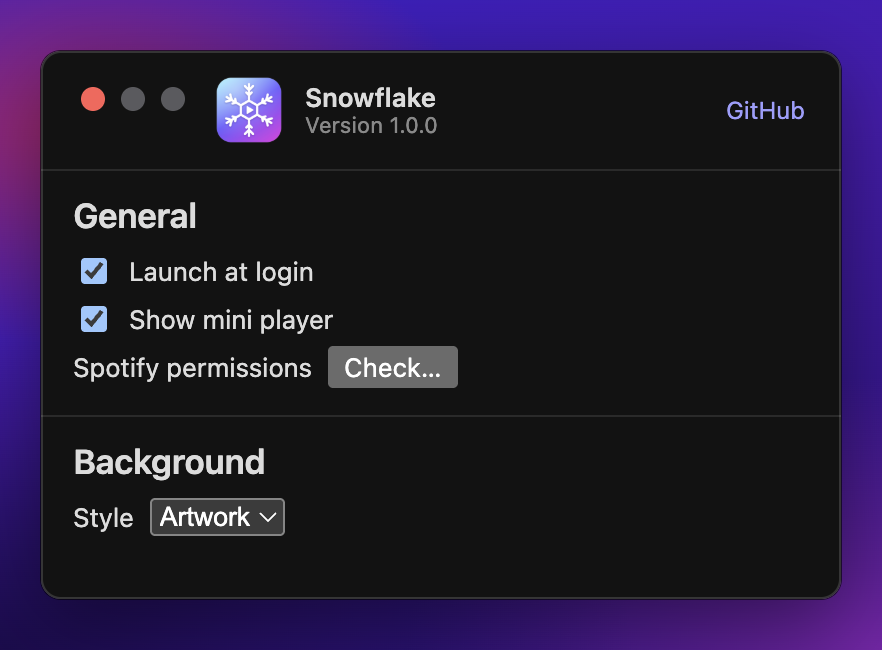

<p align="center">
  
</p>


## About
Snowflake is a macOS menu bar app, built with Electron, that displays and controls the currently playing song from Spotify.

**Snowflake supports macOS only, and Spotify only.**

## Usage

<p align="center">
  
</p>

The app shows the currently playing song in the menu bar. Clicking the menu bar item will present a window displaying details of the current track. Hovering over the album art gives you controls, and double-clicking it brings Spotify to the front. When Spotify is closed, an "Open Spotify" button launches it.

<p align="center">
  
</p>

A floating mini player, enabled by default, shows the current track and playback controls in a small window that stays on top of other apps. Drag it anywhere: its position is remembered. Double-clicking the album art opens Spotify here too. It can be turned off from the preferences or from the menu bar item's right click menu.

<p align="center">
  
</p>

The preferences window can be opened by right clicking the menu bar item.
From here you can enable launch at login, show or hide the mini player, check the Spotify permission, and change the background that appears behind the album art.

## Run

```sh
npm install
npm start
```

When launched from a terminal, macOS asks the terminal (or VS Code) for permission to control Spotify, not Snowflake.

## Build

```sh
npm run dist
```

Produces a `.dmg` and a `.zip` in `dist/`. Without a Developer ID certificate the app is ad-hoc signed, so the Automation permission has to be granted again after each rebuild.

## How it works

| Area | Implementation |
|---|---|
| Spotify data | `osascript -l JavaScript` (JXA) queries, `src/main/spotify.js` |
| Track change events | A long-running JXA process observes `com.spotify.client.PlaybackStateChanged` through `NSDistributedNotificationCenter` |
| Menu bar | `Tray` with a generated template image (animated bars) and the track title |
| Popover | Frameless `BrowserWindow` with `vibrancy: 'popover'`, `src/renderer/popover.*` |
| Mini player | Floating `BrowserWindow` of type `panel` (does not steal focus), `src/renderer/miniplayer.*` |
| Onboarding background | WebGL port of the BaseWarp shader, `src/renderer/shader.js` |
| Settings | JSON file in the app's `userData` folder |

## Attributions
- Based on [Jukebox](https://github.com/Jaysce/Jukebox), the original native Swift app by Jaysce
- Basewarp shader written by [trinketMage](https://www.shadertoy.com/view/tdG3Rd)
